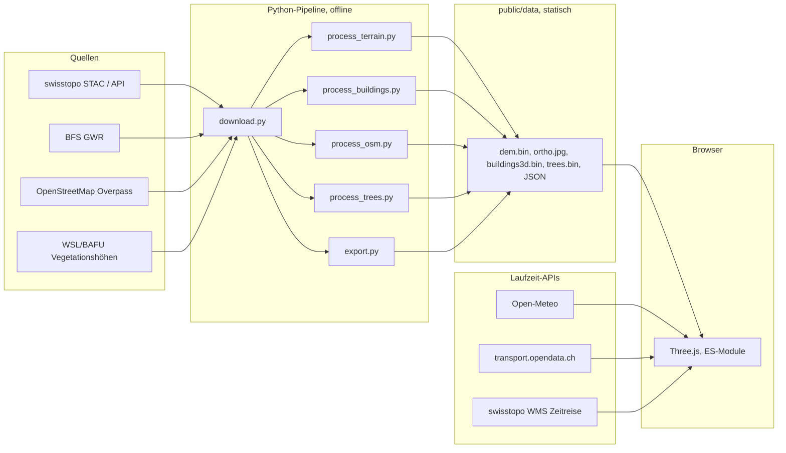

# Architektur

## Überblick

Es gibt bewusst **kein Backend**: Alle Laufzeit-APIs (Open-Meteo, transport.opendata.ch, swisstopo-WMS) erlauben CORS-Zugriffe direkt aus dem Browser. Die Datenhaltung besteht aus statischen JSON-Dateien, Binärdateien und Texturen. Ein Proxy (FastAPI oder Node) mit Caching wäre nur nötig, wenn eine API kein CORS bietet oder Schlüssel geschützt werden müssen (zum Beispiel für ÖV-Echtzeitpositionen mit opentransportdata.swiss-Token).

## Technische Entscheidungen

| Entscheidung | Begründung |
|---|---|
| Vanilla JS mit ES-Modulen und `importmap` | Kein Build-Schritt, Node nicht nötig, einfaches Hosting |
| three.js r160 lokal in `public/vendor/` (per Skript) | Offline lauffähig, feste Version, GTAOPass vorhanden |
| LV95 (EPSG:2056) als Quellsystem, lokale Koordinaten für Three.js | Float32-Genauigkeit: `x = E - E0`, `y = Höhe - 430 m`, `z = -(N - N0)`; Ursprung (2'688'000, 1'206'300) |
| Gebäude als ein zusammengeführtes Mesh | Ein Draw-Call; Auswahl über eigenen AABB- und Dreiecks-Picker, Hervorhebung über Vertexfarben |
| Gelände in 64×64-Zellen-Kacheln mit statischer Auflösung (5/10/20 m), Schürzen, flache Kacheln (See) grob | Frustum Culling pro Kachel, wenige Dreiecke, keine Risse |
| `fiona` statt GeoPandas/pyogrio für swissBUILDINGS3D | Die FileGDB enthält TIN-Z-Geometrien (Typ 1016), die pyogrio nicht liest |
| Bäume als `InstancedMesh` je 500-m-Zelle | Wenige Draw-Calls, Distanzfilter pro Zelle |
| Keine Datenbank | Alles statisch; PostGIS wäre für spätere Abfragen (Parzellen, Statistik) möglich |

## Frontend-Module (`js/`)

| Modul | Aufgabe |
|---|---|
| `main.js` | Start, Datenladen, UI-Verdrahtung |
| `api.js` | Laden und Parsen der Dateien (`dem.bin`, `buildings3d.bin`), Fortschritt |
| `geo.js` | LV95, lokale Koordinaten, WGS84 (swisstopo-Näherungsformeln) |
| `scene.js` | Renderer, Kamera, OrbitControls, EffectComposer (GTAO, Bloom), AO-Ausschlussliste |
| `terrain.js` | Gelände-Kacheln, Höhenabfrage, Strahltest gegen das Höhenraster |
| `buildings.js` | Gebäudemesh, Farbmodi, Filter, Picker |
| `features.js`, `draped.js` | Strassen, Gewässer, Bäume, Gemeindegrenze (auf das Gelände projizierte Bänder und Flächen) |
| `pois.js`, `labels.js` | POI-Marker, Ortsnamen, HTML-Beschriftungen |
| `transport.js` | Haltestellen, Linien, Abfahrten, Fahrplansimulation |
| `sky.js` | Sonnenstand (SunCalc-Algorithmus), Himmel, Licht, Schatten, Zeitzone Zürich |
| `weather.js` | Open-Meteo, Wettereffekte |
| `history.js` | Zeitachse, historische Karten, Vergleich (Shader-Erweiterung des Geländematerials) |
| `search.js` | Index und Suche (Adressen, Strassen, Gebäude, POI, Orte, Koordinaten) |
| `analysis.js` | Werkzeuge, Erweiterungspunkt `ctx.analysis.register()` |
| `controls.js` | Kameraflug, Voreinstellungen, Zeigerinteraktion (Picker-Provider) |
| `layers.js`, `inspector.js` | Ebenenliste, Informationspanel (alle Texte werden maskiert) |

Erweiterungspunkte: `ctx.providers` (neue anklickbare Objekte), `ctx.clickHandlers`, `ctx.analysis.register({ id, label, hint, onClick })`, `layers.add({ id, label, apply })`.

## Performance-Budget

| Grösse | Budget | Messung (Chrome headless, macOS, Ansichten Gemeinde / Bahnhof / Hafen) |
|---|---|---|
| Datenvolumen (ohne Vendor) | ≤ 20 MB | 17 MB (`public/data`) |
| Zeit bis bedienbar (lokal) | ≤ 3 s | 0.8–0.9 s ab Seitenaufruf (warmer Browser-Cache), `readyAfterMs` im Bericht |
| Bilder pro Sekunde mit AO und Schatten | ≥ 30 | 40–46 |
| Bilder pro Sekunde ohne AO | ≥ 60 | 66 |
| Geländedreiecke | ≤ 1.5 Mio. | 1.13 Mio. |
| Gebäudedreiecke | ≤ 0.5 Mio. | 0.17 Mio. (ein Draw-Call) |
| Draw-Calls je Frame (alle Durchgänge) | ≤ 2000 | 1165–1715 |
| JS-Heap | ≤ 250 MB | 70–160 MB |

Messung in der Anwendung: `await window.brunnen.performanceReport()` im Browser. Die Werte hängen von der Grafikkarte ab; auf schwachen GPUs hilft das Abschalten von Ambient Occlusion und Schatten in der Ebenenliste. Räumliches Chunking der Gebäude ist nicht nötig, solange ein Mesh unter 0.5 Mio. Dreiecken bleibt; bei grösseren Gebieten wäre es der nächste Schritt (Datei je Kachel, `buildings3d.bin` bereits mit Gebäudetabelle).

## Offene Punkte und technische Schulden

- Isochronen, Fussgänger-Erreichbarkeit und Velorouten: Erweiterungspunkt vorhanden (`ctx.analysis.register`), Routing-Graph aus `roads.json` fehlt.
- Schattenanalyse (Verschattung über den Tag) und Solarpotenzial (BFE sonnendach.ch): nicht umgesetzt.
- STATPOP/STATENT-Hektarraster, swissNAMES3D, Parzellen und ÖREB (Kanton Schwyz): nicht integriert.
- Luftbild mit 0.5–1 m im Zentrum (Brunnen) als zusätzliche Textur.
- Gebäude: Sockel unter den Gebäuden fehlen (an Hängen kann der Fuss schweben); Dachtexturen und Fassaden sind nicht vorhanden.
- Tunnel werden nicht dargestellt (ausgeblendet), Brücken folgen dem Gelände.
- Barrierefreiheit: Tastaturbedienung der 3D-Szene ist auf OrbitControls beschränkt; Panels sind beschriftet.
- Keine automatisierten End-to-End-Tests im CI (Browser-Tests laufen manuell über `tests/unit.html`).
- Browser-Caching über `Last-Modified`; für ein Produktivsystem sollten Dateien mit Hash im Namen und `immutable` ausgeliefert werden.
