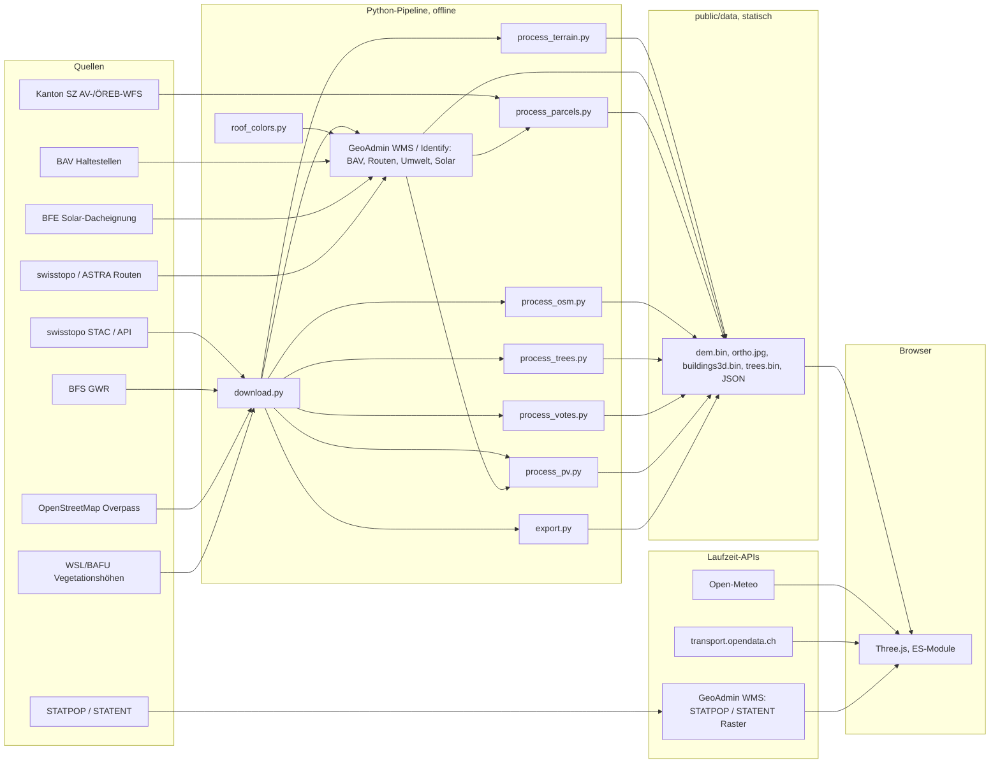

# Architektur

## Überblick

Es gibt bewusst **kein Backend**: Die Laufzeit-APIs (Open-Meteo, transport.opendata.ch und GeoAdmin WMS/Identify) erlauben CORS-Zugriffe direkt aus dem Browser. Die Abstimmungsdaten des BFS erlauben das nicht (und umfassen 6 MB je Tag); die Pipeline zieht darum die Gemeinderesultate einmal nach `votes.json`. Die Datenhaltung besteht aus statischen JSON-Dateien, Binärdateien und Texturen. Ein Proxy wäre erst für geschützte Schlüssel, CORS-beschränkte Quellen oder serverseitige Routinggraphen nötig.

## Technische Entscheidungen

| Entscheidung | Begründung |
|---|---|
| Vanilla JS mit ES-Modulen und `importmap` | Kein Build-Schritt, Node nicht nötig, einfaches Hosting |
| three.js r160 lokal in `public/vendor/` (per Skript) | Offline lauffähig, feste Version, GTAOPass vorhanden |
| LV95 (EPSG:2056) als Quellsystem, lokale Koordinaten für Three.js | Float32-Genauigkeit: `x = E - E0`, `y = Höhe - 430 m`, `z = -(N - N0)`; Ursprung (2'688'000, 1'206'300) |
| Gebäude als ein zusammengeführtes Mesh mit einem Shader | Ein Draw-Call. Pro Vertex stehen Fassaden-/Dachfarbe, Fläche-Typ, Geschosszahl und Ladenstil als Attribute bereit; Fenster, Läden und Dachziegel entstehen prozedural im Fragment-Shader (kein Geometrie- oder Texturaufwand). Auswahl über eigenen AABB- und Dreiecks-Picker |
| Gebäude ↔ Parzelle | AV-Grundstücke aus dem Schwyzer WFS werden anhand des LV95-Modellmittelpunkts räumlich zugeordnet. Das AV-Schema stellt in diesem Dienst kein EGRID bereit; die Zuordnung ist deshalb keine amtliche Identifikatorverknüpfung und Eigentümerdaten werden nicht bezogen. |
| Photovoltaik als Instanzen auf Dachebenen | Die Register-Anlagen werden zur Laufzeit auf die Dachebenen gelegt (rund 20'000 Module, 3 Draw-Calls, nur unter 2.2 km Blickabstand sichtbar). Gemessen ist nur das Register; Modulzahl und -lage sind eine dokumentierte Simulation |
| Verkehr nur in Blicknähe | Höchstens 130 Autos und 360 Personen, Startpunkte im Ring um den Blickpunkt (nie im Bild), Anzahl wächst mit dem Blickabstand, bei Nacht, Regen und Schnee weniger; die Bewegung ist reine Rechnung auf Polylinien ohne Physik |
| Fahrzeuge und Ausstattung als Bausatz (`models.js`) | Wenige Quader und Zylinder mit Vertexfarben, per `InstancedMesh`/Gruppen eingesetzt: schlank, einheitlich, kein Asset-Download. Einzelne Fotomodelle wären teurer in Grösse und Pflege |
| Wetter am Bildschirm statt im Raum | Das Overlay (`#weather-overlay`) deckt immer das ganze Blickfeld ab; zusätzlich Partikel um den Blickpunkt (Radius folgt dem Kameraabstand). So ist Wetter bei jedem Zoom sichtbar |
| Nachtbeleuchtung ohne Lichtflut | Leuchtende Fenster im Gebäude-Shader, Laternenköpfe und Lichtflecken als additive Instanzen, nur 8 echte Punktlichter nahe am Blickpunkt, Bloom bei Dunkelheit |
| Gelände in 64×64-Zellen-Kacheln mit statischer Auflösung (5/10/20 m), Schürzen, flache Kacheln (See) grob | Frustum Culling pro Kachel, wenige Dreiecke, keine Risse |
| `fiona` statt GeoPandas/pyogrio für swissBUILDINGS3D | Die FileGDB enthält TIN-Z-Geometrien (Typ 1016), die pyogrio nicht liest |
| Bäume als `InstancedMesh` je 500-m-Zelle und Art, Detailstufen mit gemeinsamen Instanzdaten | Hohe Stufe (rund 150 Dreiecke Laub, 90 Nadel) unter 380 m Abstand mit Schattenwurf, niedrige Stufe (rund 30 Dreiecke) bis 3.8 km; Wind per `onBeforeCompile` ohne CPU-Aufwand |
| Boden als Shader-Simulation | Das Luftbild (global 2 m, nah 0.3 m) liefert nur die Klasse und die grobe Helligkeit; Wiese, Waldboden und Fels entstehen aus mehrstufigem Rauschen im Fragment-Shader, mit Abstandsüberblendung gegen Flimmern. Keine zusätzlichen Daten oder Texturen |
| Keine Datenbank | Alles statisch; PostGIS wäre für spätere Abfragen (Parzellen, Statistik) möglich |

## Frontend-Module (`js/`)

| Modul | Aufgabe |
|---|---|
| `main.js` | Start, Datenladen, UI-Verdrahtung, Qualitätsstufe (Touch/schwache CPU) |
| `api.js` | Laden und Parsen der Dateien (`dem.bin`, `buildings3d.bin` v2), Fortschritt |
| `geo.js` | LV95, lokale Koordinaten, WGS84 (swisstopo-Näherungsformeln) |
| `scene.js` | Renderer, Kamera, OrbitControls (linke Taste verschiebt, Grenzen), EffectComposer (GTAO, Bloom), AO-Ausschlussliste |
| `terrain.js` | Gelände-Kacheln, Höhenabfrage, Strahltest; Shader für simulierten Boden, historische Karte und scharfe Nahkachel |
| `ride.js`, `bike-model.js` | Velomodus (Taste V oder Velo-Knopf): Intro schräg von vorne, Kamerafahrt um den Fahrer in die Spielkamera, dann Steuerung mit Pfeiltasten/WASD, Leertaste Klingel, Esc beendet. Max. 40 km/h auf Strassen, 25 km/h im Gelände; hält vor Gebäuden (Strahltest), Bäumen, See, Autos, Personen, Modellrand und sehr steilem Gelände. Autos und Personen warten vor dem Velo. Modell: Velo, gelber Anhänger, Australian Shepherd aus Grundkörpern |
| `grading.js` | Strassen ins Gelände legen (Vorbild speicher.mlanalytica.com): 2-m-Strassenraster, Glättung nur im Netz (Haarnadelkurven getrennt), Abtrag/Aufschüttung mit Böschungen bis 13 m (max. ±4 m, unter der Fahrbahn ±6 m); See, Gebäude (3 m Schutzzone), Brücken und Tunnel bleiben unverändert. `terrain.heightAt` liefert auf Strassen die geglättete Fahrbahn, `terrain.rawHeightAt` das Originalgelände (Höhenprofile). Vergleich ohne Einebnung: `?grading=0` |
| `roadmarks.js` | Mittel- und Randlinien aus Strassenklasse und -breite, Unterbruch bei Kreuzungen (über den Segmentindex mit Strassen-Besitzer) |
| `track.js` | Gleise: Schotterbett mit Schwellentextur (UV nach Laufmeter), zwei Schienenbänder, Schienen nur unter 1.5 km Blickabstand |
| `vehicles.js` | Modelle und Materialien für den Alltag: Autos als Querschnitts-Lofts mit Glas, Felgen, Leuchten und Klarlack-Material (Materialcode je Dreieck, Himmelsumgebung), Personen und Hunde mit Gehbewegung im Vertex-Shader |
| `ambient.js` | Simulierter Alltag: Netz aus Strassen und Trottoirs, Agenten (Autos mit Folgeabstand, Personen), Startpunkte in Blicknähe, eine Instanz-Gruppe je Fahrzeugtyp |
| `ground.js` | Bodenansicht wählen: Simulation (Vorgabe), Luftbild, Landeskarte (WMS, global und als Nahkachel über `hires.js`) |
| `trees.js` | Bäume: Laub-/Nadelbaum-Geometrie, Art und Farbe aus dem Luftbild, Wind im Vertex-Shader, zwei Detailstufen je 500-m-Zelle |
| `buildings.js` | Gebäudemesh und -shader, Dorfbild (Fassade, Dach, Fenster), Farbmodi, Filter, Picker |
| `models.js` | Bausatz: Haltestellen, Bahnsteig, Schiffsteg, Postauto, SBB-Zug, Kursschiff, Laternen |
| `lighting.js` | Strassenlaternen, Nachtbeleuchtung, Leuchteffekt |
| `pv.js` | Photovoltaik: Dachebenen aus der Gebäudegeometrie (Dreiecke gleicher Ebene zusammengefasst), Modulraster, Zuordnung nach Ausrichtung/Neigung, glänzende Module (`MeshPhysicalMaterial`, Himmelsumgebung, Instanzen je Bauart) |
| `hires.js` | Scharfes Luftbild (WMS) in Blicknähe |
| `register.js` | Registergebäude ohne 3D-Modell (schematisch) |
| `roadindex.js` | Räumlicher Index über Strassen und Bahn (Ausrichtung von Haltestellen und Laternen) |
| `features.js`, `draped.js` | Strassen, Gewässer, Bäume, Gemeindegrenze (auf das Gelände projizierte Bänder und Flächen) |
| `pois.js`, `labels.js` | POI-Marker (skalieren mit dem Kameraabstand), Ortsnamen, HTML-Beschriftungen |
| `transport.js` | Haltestellen, Linien, Abfahrten, Fahrplansimulation |
| `routing.js` | Lokaler Fussweggraph aus `roads.json`, nächster Wegknoten, kürzeste Route und erreichbare Wegsegmente; Gehzeit mit 75 m/min geschätzt |
| `walking.js` | 5/10/15-Minuten-Wegenetz, Ergebnisliste aus OSM-POIs und Haltestellen, Kategorienfilter und hervorgehobene Zielroute |
| `official-routes.js` | Gemeinsame GeoAdmin-WMS/FeatureInfo-Ansichten für Wanderwege, Veloland, Sperrungen, Lärm und Aquaprotect |
| `construction.js` | Baustellen Kantonsstrassen (Kanton Schwyz, WFS A083a): Parser, Canvas-Zeichnung und Detailansicht, eingebunden im Modus «Sperrungen und Baustellen» |
| `solar-potential.js` | BFE-Dachpotenzial nach EGID, Modellwerte und Dachflächenzuordnung zur bestehenden 3D-Geometrie |
| `sky.js` | Sonnenstand (SunCalc-Algorithmus), Himmel, Sterne, Licht, Schatten, Zeitzone Zürich |
| `weather.js` | Open-Meteo, Vorgaben, Wettereffekte (Overlay und Partikel) |
| `history.js` | Eigenständige neutrale Zeitreise, GWR-Jahresfilter, Zustandssicherung und -wiederherstellung |
| `map-navigation.js` | Kartentyp-Kacheln, Touch-/Hover-Schnellzugriffe, Gebäudemodi und Kartendetails |
| `search.js` | Index und Suche (Adressen, Strassen, Gebäude, POI, Orte, Koordinaten) |
| `analysis.js` | Werkzeuge, Erweiterungspunkt `ctx.analysis.register()` |
| `almanac.js` | Almanach: Zahlen, Energie, Abstimmungen, Datenqualität, Quellen |
| `demographics.js` | STATPOP/STATENT: 100-m-Rasterkarten, GeoAdmin-Zellabfrage, Zellklick und Gebäudeumfeldwerte |
| `controls.js` | Manuelle Kamera-Voreinstellungen und Drehungen, Zeigerinteraktion (Picker-Provider); keine automatische Startfahrt |
| `layers.js`, `inspector.js` | Ebenenliste, Informationspanel (alle Texte werden maskiert) |

Die Oberfläche (`index.html`, `css/main.css`) hält die 3D-Karte im Zentrum: Kartentyp-Kacheln und vier Schnellzugriffe liegen unten links; «Mehr» öffnet die gruppierten Kartendetails. Bei Touchgeräten lässt sich die Schnellzugriffsleiste über die Pfeiltaste erweitern. Die Zeitreise nutzt einen eigenen unteren Regler, springt beim Einstieg ohne Animation in die Vogelperspektive, neutralisiert den Boden, setzt Zeit/Wetter auf heute 12:00 und klar, blendet thematische Ebenen aus und stellt beim Verlassen alle vorherigen Zustände einschliesslich Kamera wieder her. Ein per Vertexattribut gespeicherter GWR-Zeitraum steuert den GPU-Dither-Fade ohne einzelne Gebäudeobjekte oder zusätzliche Draw Calls; das Tempo sinkt von 3× auf 0.5× bei 1980, danach bleibt es konstant. Während des Timelapses bewegt sich die Kamera nicht.

Erweiterungspunkte: `ctx.providers` (neue anklickbare Objekte), `ctx.clickHandlers`, `ctx.analysis.register({ id, label, hint, onClick })`, `layers.add({ id, label, apply })`.

Gebäudeprofil und geführte Kartenanalysen verwenden zusätzlich eine gemeinsame Session in `main.js`: Kameraziel/-perspektive, Layerzustand und Zeit-/Wettermodus werden beim Einstieg gesichert und beim Verlassen restauriert. Die Auswahl im Analysepanel unterscheidet Bevölkerung, Arbeit, Fusswege, Wanderwege, Velorouten, Sperrungen, Solar, Lärm und Hochwasser. `analysis.js` bleibt separat für zeigerbasierte Werkzeuge (Messen/Punktabfrage), nicht für diese Themenmodi.

Fussrouting wird lokal auf dem vorbereiteten OSM-Netz berechnet. Die Pipeline exportiert `highway`, `walk`, `surface` und `incline`; der Browser schliesst als nicht begehbar markierte Wege aus, snappt Gebäude/Ziele bis 60 m auf das Netz und verwendet Dijkstra für Wegstrecken. Die Gehzeit verwendet im Basismodell 75 m/min (mit Aufschlag für `highway=steps`); Steigung, individuelle Gehgeschwindigkeit und laufende Sperrungen sind nicht eingerechnet. Das Wegenetz reicht nur bis zum 300-m-Puffer der Gemeindegrenze.

Die Wohnumfeld-Orientierung fasst Luftlinien zu erfassten Alltagsorten in drei gleich gewichteten Bereichen zusammen. Nutzerprioritäten ändern die Gewichtung nur lokal. Unter 2 verfügbaren Bereichen wird kein Wert berechnet; fehlende Objekte gelten nicht als negativ. Das ist eine unverbindliche Orientierung, keine amtliche oder professionelle Immobilienbewertung.

## Performance-Budget

| Grösse | Budget | Messung |
|---|---|---|
| Datenvolumen (ohne Vendor) | ≤ 20 MB | 17 MB (`public/data`: Gebäude 9.3 MB + 1.1 MB JSON, Gelände 3 MB, Luftbild 2.4 MB, Bäume 0.5 MB, übrige JSON 1.5 MB) |
| Zeit bis bedienbar (lokal) | ≤ 3 s | 2.6 s (`readyAfterMs`, kalter Seitenaufruf) |
| Bilder pro Sekunde mit AO und Schatten | ≥ 30 | 55–58 (Apple Silicon, Chrome, Ansicht Gemeinde/Brunnen) |
| Geländedreiecke | ≤ 1.5 Mio. | 1.13 Mio. |
| Gebäudedreiecke | ≤ 0.5 Mio. | 0.17 Mio. (ein Draw-Call) |
| Draw-Calls je Frame (alle Durchgänge) | ≤ 2000 | 830–1600 |
| JS-Heap | ≤ 250 MB | 75–80 MB |

Messung in der Anwendung: `await window.brunnen.performanceReport()`. Die Werte stammen aus Stichproben auf einem Entwicklungsrechner; auf iPhone/Safari und schwachen GPUs wurde nicht gemessen. Auf Touch-Geräten und bei höchstens 4 CPU-Kernen startet die Anwendung ohne Ambient Occlusion, mit kleinerer Schattenkarte (2048) und kleinerem hochauflösenden Geländering.

## Offene Punkte und technische Schulden

- Velomodus ist als freies Fahren umgesetzt (`ride.js`); detaillierte, höhen-/zugangsabhängige Fuss- und Veloroutenbewertung ist nicht umgesetzt. Velomodus auf Smartphones (Kompass-Joystick) ist ungetestet.
- Fuss-Erreichbarkeit ist ein Netzwerkausschnitt, keine vollständige Isochrone: mittlere Gehgeschwindigkeit statt individueller Gehprofile, Gelände-/Steigungsaufwand und dynamische Wegsperren fehlen.
- Offizielle Wander- und Velorouten werden als GeoAdmin-WMS dargestellt; Höhenprofile, Streckenplanung und automatische Umleitung bleiben offen. Sperrungsmeldungen werden nicht als Freigaben interpretiert.
- Solar nutzt die BFE-Eignungskarte (Datenstand 2023-02-21), verknüpft über EGID und vorhandene 3D-Dachflächen. Die Modellproduktion ist keine Prognose für ein konkretes Anlagendesign; fehlende EGID- oder Dachübereinstimmung verhindert die Dachfärbung.
- Aquaprotect ist eine grobe BAFU-Übersicht (Datenstand 2008), keine aktuelle Warnung und keine parzellenscharfe Naturgefahrenkarte.
- STATPOP/STATENT sind als dynamische 100-m-Rasterlayer und Zellwerte integriert. Einwohner- und VZÄ-Werte gelten nur für die Rasterzelle, nicht für einzelne Gebäude oder Personen; Zuverlässigkeitscodes sind noch nicht interpretiert. swissNAMES3D ist nicht integriert. AV-Parzellen und ÖREB-Grundnutzungs-/Überlagerungsflächen sind als Umrisslayer vorhanden; die Gebäudezuordnung basiert auf dem Mittelpunkt, weil kein EGRID geliefert wird. Rechtsverbindlichkeit und Gültigkeit liefert das abgerufene Nutzungsplanungs-Feature-Schema nicht.
- Gebäude: Sockel fehlen (an Hängen kann der Fuss schweben); Fassaden, Fensterläden und Fenster sind gestalterisch.
- Tunnel werden nicht dargestellt (ausgeblendet), Brücken folgen dem Gelände.
- Test auf iPhone/Safari und schwachen GPUs steht aus; die Qualitätsstufe ist eine Annahme (Touch oder höchstens 4 Kerne).
- Barrierefreiheit: Tastaturbedienung der 3D-Szene (Pfeile, Q/E, T, H); Panels sind beschriftet. Bildschirmleser können die Szene nicht erfassen.
- Keine automatisierten End-to-End-Tests im CI (Browser-Tests laufen manuell über `tests/unit.html`; `window.testResults` ist maschinenlesbar).
- Browser-Caching über `Last-Modified`; für ein Produktivsystem sollten Dateien mit Hash im Namen und `immutable` ausgeliefert werden.
