# Architektur

## Überblick

```mermaid
flowchart LR
  subgraph Quellen
    S[swisstopo STAC / API]
    B[BFS GWR]
    O[OpenStreetMap Overpass]
    V[WSL/BAFU Vegetationshöhen]
  end
  subgraph Pipeline[Python-Pipeline, offline]
    D[download.py]
    T[process_terrain.py]
    G[process_buildings.py]
    M[process_osm.py]
    R[process_trees.py]
    Q[process_votes.py]
    C[roof_colors.py]
    E[export.py]
  end
  subgraph Daten[public/data, statisch]
    F[dem.bin, ortho.jpg, buildings3d.bin, trees.bin, JSON]
  end
  subgraph Browser
    JS[Three.js, ES-Module]
  end
  subgraph Laufzeit-APIs
    W[Open-Meteo]
    P[transport.opendata.ch]
    Z[swisstopo WMS Zeitreise]
  end
  S --> D
  B --> D
  O --> D
  V --> D
  D --> T & G & M & R & Q & E
  C --> G
  T & G & M & R & Q & E --> F
  F --> JS
  W --> JS
  P --> JS
  Z --> JS
```

Es gibt bewusst **kein Backend**: Alle Laufzeit-APIs (Open-Meteo, transport.opendata.ch, swisstopo-WMS) erlauben CORS-Zugriffe direkt aus dem Browser. Die Abstimmungsdaten des BFS erlauben das nicht (und umfassen 6 MB je Tag); die Pipeline zieht darum die Gemeinderesultate einmal nach `votes.json`. Die Datenhaltung besteht aus statischen JSON-Dateien, Binärdateien und Texturen. Ein Proxy (FastAPI oder Node) mit Caching wäre nur nötig, wenn eine API kein CORS bietet oder Schlüssel geschützt werden müssen (zum Beispiel für ÖV-Echtzeitpositionen mit opentransportdata.swiss-Token).

## Technische Entscheidungen

| Entscheidung | Begründung |
|---|---|
| Vanilla JS mit ES-Modulen und `importmap` | Kein Build-Schritt, Node nicht nötig, einfaches Hosting |
| three.js r160 lokal in `public/vendor/` (per Skript) | Offline lauffähig, feste Version, GTAOPass vorhanden |
| LV95 (EPSG:2056) als Quellsystem, lokale Koordinaten für Three.js | Float32-Genauigkeit: `x = E - E0`, `y = Höhe - 430 m`, `z = -(N - N0)`; Ursprung (2'688'000, 1'206'300) |
| Gebäude als ein zusammengeführtes Mesh mit einem Shader | Ein Draw-Call. Pro Vertex stehen Fassaden-/Dachfarbe, Fläche-Typ, Geschosszahl und Ladenstil als Attribute bereit; Fenster, Läden und Dachziegel entstehen prozedural im Fragment-Shader (kein Geometrie- oder Texturaufwand). Auswahl über eigenen AABB- und Dreiecks-Picker |
| Fahrzeuge und Ausstattung als Bausatz (`models.js`) | Wenige Quader und Zylinder mit Vertexfarben, per `InstancedMesh`/Gruppen eingesetzt: schlank, einheitlich, kein Asset-Download. Einzelne Fotomodelle wären teurer in Grösse und Pflege |
| Wetter am Bildschirm statt im Raum | Das Overlay (`#weather-overlay`) deckt immer das ganze Blickfeld ab; zusätzlich Partikel um den Blickpunkt (Radius folgt dem Kameraabstand). So ist Wetter bei jedem Zoom sichtbar |
| Nachtbeleuchtung ohne Lichtflut | Leuchtende Fenster im Gebäude-Shader, Laternenköpfe und Lichtflecken als additive Instanzen, nur 8 echte Punktlichter nahe am Blickpunkt, Bloom bei Dunkelheit |
| Gelände in 64×64-Zellen-Kacheln mit statischer Auflösung (5/10/20 m), Schürzen, flache Kacheln (See) grob | Frustum Culling pro Kachel, wenige Dreiecke, keine Risse |
| `fiona` statt GeoPandas/pyogrio für swissBUILDINGS3D | Die FileGDB enthält TIN-Z-Geometrien (Typ 1016), die pyogrio nicht liest |
| Bäume als `InstancedMesh` je 500-m-Zelle | Wenige Draw-Calls, Distanzfilter pro Zelle |
| Keine Datenbank | Alles statisch; PostGIS wäre für spätere Abfragen (Parzellen, Statistik) möglich |

## Frontend-Module (`js/`)

| Modul | Aufgabe |
|---|---|
| `main.js` | Start, Datenladen, UI-Verdrahtung, Qualitätsstufe (Touch/schwache CPU) |
| `api.js` | Laden und Parsen der Dateien (`dem.bin`, `buildings3d.bin` v2), Fortschritt |
| `geo.js` | LV95, lokale Koordinaten, WGS84 (swisstopo-Näherungsformeln) |
| `scene.js` | Renderer, Kamera, OrbitControls (linke Taste verschiebt, Grenzen), EffectComposer (GTAO, Bloom), AO-Ausschlussliste |
| `terrain.js` | Gelände-Kacheln, Höhenabfrage, Strahltest; Shader für historische Karte und scharfes Luftbild |
| `buildings.js` | Gebäudemesh und -shader, Dorfbild (Fassade, Dach, Fenster), Farbmodi, Filter, Picker |
| `models.js` | Bausatz: Haltestellen, Bahnsteig, Schiffsteg, Postauto, SBB-Zug, Kursschiff, Laternen |
| `lighting.js` | Strassenlaternen, Nachtbeleuchtung, Leuchteffekt |
| `hires.js` | Scharfes Luftbild (WMS) in Blicknähe |
| `register.js` | Registergebäude ohne 3D-Modell (schematisch) |
| `roadindex.js` | Räumlicher Index über Strassen und Bahn (Ausrichtung von Haltestellen und Laternen) |
| `features.js`, `draped.js` | Strassen, Gewässer, Bäume, Gemeindegrenze (auf das Gelände projizierte Bänder und Flächen) |
| `pois.js`, `labels.js` | POI-Marker (skalieren mit dem Kameraabstand), Ortsnamen, HTML-Beschriftungen |
| `transport.js` | Haltestellen, Linien, Abfahrten, Fahrplansimulation |
| `sky.js` | Sonnenstand (SunCalc-Algorithmus), Himmel, Sterne, Licht, Schatten, Zeitzone Zürich |
| `weather.js` | Open-Meteo, Vorgaben, Wettereffekte (Overlay und Partikel) |
| `history.js` | Zeitachse, historische Karten, Vergleich |
| `search.js` | Index und Suche (Adressen, Strassen, Gebäude, POI, Orte, Koordinaten) |
| `analysis.js` | Werkzeuge, Erweiterungspunkt `ctx.analysis.register()` |
| `almanac.js` | Almanach: Zahlen, Energie, Abstimmungen, Datenqualität, Quellen |
| `controls.js` | Kameraflug, Voreinstellungen, Drehen per Taste, Zeigerinteraktion (Picker-Provider) |
| `layers.js`, `inspector.js` | Ebenenliste, Informationspanel (alle Texte werden maskiert) |

Die Oberfläche (`index.html`, `css/main.css`) folgt gestalterisch dem Vorbild Speicher AR: halbtransparente, unscharf hinterlegte Panels (Identität und Suche oben links, Uhr und Himmel oben Mitte, Ansicht oben rechts, Ebenen links mit einklappbaren Abschnitten, Inspector rechts, Almanach unten rechts), Hell- und Dunkelthema über CSS-Variablen, Systemschriften ohne externe Dienste.

Erweiterungspunkte: `ctx.providers` (neue anklickbare Objekte), `ctx.clickHandlers`, `ctx.analysis.register({ id, label, hint, onClick })`, `layers.add({ id, label, apply })`.

## Performance-Budget

| Grösse | Budget | Messung |
|---|---|---|
| Datenvolumen (ohne Vendor) | ≤ 20 MB | 17 MB (`public/data`: Gebäude 9.3 MB + 1.1 MB JSON, Gelände 3 MB, Luftbild 2.4 MB, Bäume 0.5 MB, übrige JSON 1.5 MB) |
| Zeit bis bedienbar (lokal) | ≤ 3 s | 2.6 s (`readyAfterMs`, kalter Seitenaufruf) |
| Bilder pro Sekunde mit AO und Schatten | ≥ 30 | 55–58 (Apple Silicon, Chrome, Ansicht Gemeinde/Brunnen) |
| Geländedreiecke | ≤ 1.5 Mio. | 1.13 Mio. |
| Gebäudedreiecke | ≤ 0.5 Mio. | 0.17 Mio. (ein Draw-Call) |
| Draw-Calls je Frame (alle Durchgänge) | ≤ 2000 | 830–1600 |
| JS-Heap | ≤ 250 MB | 75–80 MB |

Messung in der Anwendung: `await window.brunnen.performanceReport()`. Die Werte stammen aus Stichproben auf einem Entwicklungsrechner; auf iPhone/Safari und schwachen GPUs wurde nicht gemessen. Auf Touch-Geräten und bei höchstens 4 CPU-Kernen startet die Anwendung ohne Ambient Occlusion, mit kleinerer Schattenkarte (2048) und kleinerem hochauflösenden Geländering.

## Offene Punkte und technische Schulden

- Solarpotenzial und PV-Modi (BFE sonnendach.ch), Objektprofil, Fahrmodus: nicht umgesetzt.
- Isochronen, Fussgänger-Erreichbarkeit und Velorouten: Erweiterungspunkt vorhanden (`ctx.analysis.register`), Routing-Graph aus `roads.json` fehlt.
- STATPOP/STATENT-Hektarraster, swissNAMES3D, Parzellen und ÖREB (Kanton Schwyz): nicht integriert.
- Gebäude: Sockel fehlen (an Hängen kann der Fuss schweben); Fassaden, Fensterläden und Fenster sind gestalterisch.
- Tunnel werden nicht dargestellt (ausgeblendet), Brücken folgen dem Gelände.
- Test auf iPhone/Safari und schwachen GPUs steht aus; die Qualitätsstufe ist eine Annahme (Touch oder höchstens 4 Kerne).
- Barrierefreiheit: Tastaturbedienung der 3D-Szene (Pfeile, Q/E, T, H); Panels sind beschriftet. Bildschirmleser können die Szene nicht erfassen.
- Keine automatisierten End-to-End-Tests im CI (Browser-Tests laufen manuell über `tests/unit.html`; `window.testResults` ist maschinenlesbar).
- Browser-Caching über `Last-Modified`; für ein Produktivsystem sollten Dateien mit Hash im Namen und `immutable` ausgeliefert werden.
